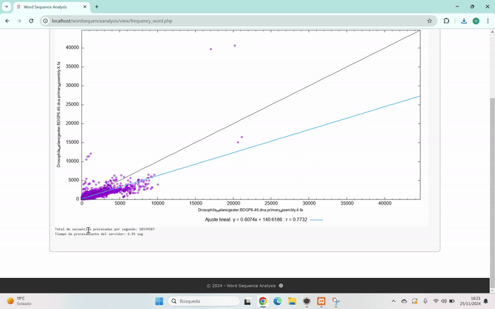
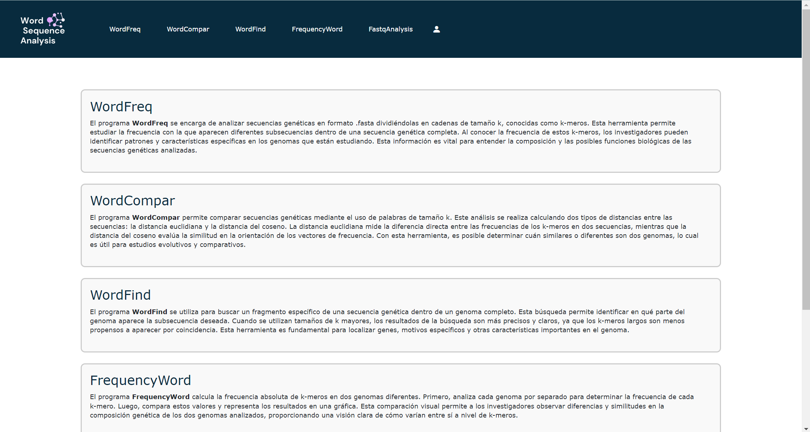
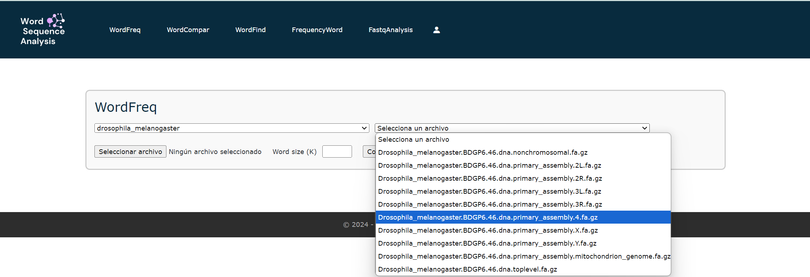
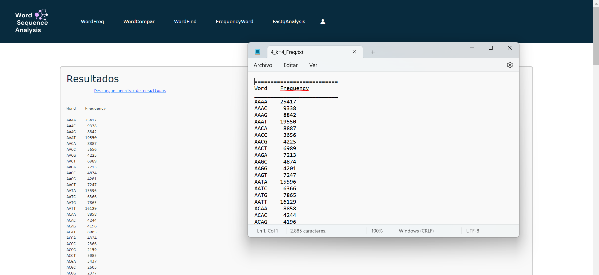
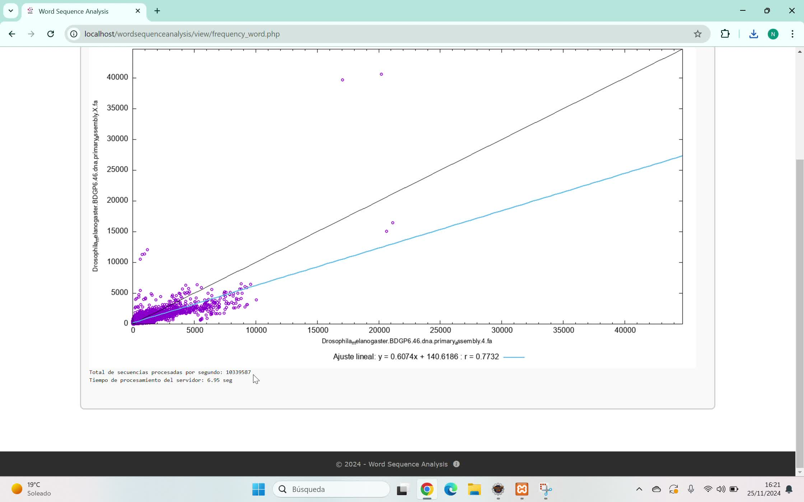

# Análisis de secuencias de ADN y distancias entre genomas

Trabajo de Fin de Grado (Ingeniería Multimedia, Universitat de València). Aplicación web en PHP (arquitectura MVC) para el análisis de secuencias de ADN en formato FASTA/FASTQ y la medición de distancias genéticas entre genomas de distintas especies.



🎬 [Ver demo completa en vídeo](media/demo.mp4) (90s)

## Capturas

| Página de inicio | Selección de secuencias |
|---|---|
|  |  |

| Resultados (tabla) | Resultados (gráfica de distancias) |
|---|---|
|  |  |

## Funcionalidades

- Carga y gestión de genomas (añadir/eliminar especies, actualización desde fuentes externas).
- Análisis de frecuencia de palabras/k-mers en secuencias de ADN.
- Comparación de secuencias y cálculo de distancias genéticas entre genomas.
- Análisis de archivos FASTQ.
- Resultados visuales y textuales (gráficas y tablas) de las propiedades y distancias calculadas.
- Sistema de sesión/login y copias de seguridad de la base de datos.

## Tecnologías

- **Backend:** PHP (MVC: `model/`, `view/`, `control/`)
- **Base de datos:** MySQL/MariaDB
- **Frontend:** HTML, CSS, JavaScript

## Estructura

```
wordsequenceanalysis/
├── control/     # Controladores (lógica de cada acción)
├── model/       # Acceso a datos
├── view/        # Vistas PHP
├── css/ js/ img/
├── database/    # Dump de ejemplo (sequences.sql)
├── index.php    # Punto de entrada
└── TFG.php      # Utilidades de la app
```

## Puesta en marcha (entorno local, p. ej. XAMPP)

1. Copia el proyecto a `htdocs/` de tu servidor Apache/PHP local.
2. Crea una base de datos MySQL llamada `sequences` e importa `database/sequences.sql`.
3. La conexión por defecto usa `localhost` / usuario `root` sin contraseña (ver `model/acceso_bd.php`); ajústala a tu entorno si es necesario.
4. Abre la aplicación desde el navegador (p. ej. `http://localhost/wordsequenceanalysis/`).

## Memoria del TFG

La memoria completa del trabajo (contexto, estado del arte, diseño y resultados) está disponible bajo petición.

---

**Autora:** Naiara Ohiane Gordillo Ferreiro · [github.com/ohianee](https://github.com/ohianee)
